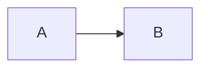

# `pdfmarq.md`

Markdown engine: markdown content drawn into the current frame of a `PDF`.
Requires `pip install pdfmarq[md]`.

The engine draws content only.
The page around it - banner, header, footer, signing lines - belongs to a document package:

- [`pdfmarq.paper`](../paper/readme.md): documentation with a frontmatter banner, `md_to_pdf` and `md_into`
- [`pdfmarq.legal`](../legal/readme.md): letters, statements, contracts, parallel versions, `md_to_pdf` and `md_parallel_to_pdf`

## Engine API

```py
from pdfmarq import PDF
from pdfmarq.md import MarkdownRenderer, MarkdownStyle

pdf = PDF("out.pdf")
renderer = MarkdownRenderer(pdf, MarkdownStyle(), base_dir=".")
renderer.render(text) # parse + index + render_tokens, frontmatter dropped
pdf.save()
```

`render()` draws a whole document at once.
A package that lays out the page itself works in steps:

- `renderer.parse(text)` returns tokens, frontmatter dropped
- `renderer.index(tokens)` registers the heading slugs `[text](#slug)` links resolve to, once per document before any part is drawn;
  `index(tokens, prefix="v2-")` keeps the anchors of one of several documents in a file apart from those of the others
- `renderer.render_tokens(tokens[a:b])` draws any slice into the current frame
- `renderer.render_tokens(part, style)` sets that part in a style of its own; heading slugs and equation numbers run on across parts
- `MarkdownRenderer.off_page(width, style, base_dir, font_dir)` is the engine on an off-page sheet, measuring a part before it is drawn
- `renderer.resolve_path(src)` resolves a path against `base_dir`
- `renderer.frontmatter_file(fm, key)` gives the file a frontmatter key names, warning when it is missing

Functions of `pdfmarq.md` go with them:

- `top_blocks(tokens)` gives `(start, end)` of each top-level block, a `<!-- group -->` counting as one
- `split_frontmatter(text)`, `metadata_from_frontmatter(fm)` and `pdf_metadata(fm, overrides)` read frontmatter, which the engine itself never draws

Inside `pdf.columns(...)` content width, margins and page breaks follow the current column, so every block - tables, lists, images, formulas - flows through columns unchanged.

## Flowing text

```py
MarkdownStyle(justify=True, hyphenate="pl", keep_together=False, h2_size=None)
```

- `justify` sets paragraphs flush to both edges.
  A line may tighten its spaces to three quarters of their width to take one more word, as page layout programs do.
  The last line and a line a hard break ends stay left.
- `hyphenate` names the language whose `pyphen` patterns split words at the end of a paragraph line.
  Headings and table cells keep their words whole.
- `keep_together=False` lets text flow, so columns end evenly.
  A paragraph splits with at least two lines on each side, and a list goes item by item.
  A heading reserves room for itself, as drawn, and three lines of the text after it.
  Before a table, code block, image or formula it reserves the first rows or lines of that block, as with `keep_together` on.
  Quotes, callouts and groups always stay whole.
- A heading size of `None` follows `body_size`.
- An ordered list keeps its delimiter, `1.` or `1)`, and the author's numbers when they increase.

The defaults - `justify=False`, `hyphenate=None`, `keep_together=True`, sizes 20/16/13/11 - give the classic documentation look.

## Math

Two engines draw `$x^2$` and `$$...$$`, both to vector paths:

| `math_engine` | Renderer | Covers | Needs |
| ------------- | -------- | ------ | ----- |
| `auto` _(default)_ | MathJax, else mathtext | whichever is installed | - |
| `mathjax` | MathJax 4 | LaTeX math: `\underbrace` with its label, `\begin{cases}`, `\substack`, stretchable delimiters | Node + two npm packages |
| `mathtext` | matplotlib mathtext | a subset - no brace accents, no cases | `matplotlib` only |

```bash
npm install -g mathjax @mathjax/mathjax-newcm-font
```

`math_font` picks typeface, from font packages MathJax ships.
Each was measured against 230 TeX symbols a technical document reaches for - Greek, operators, relations, arrows, set and logic notation, blackboard, script and fraktur alphabets, stretchable delimiters, accents, `cases`, `substack`, matrices, and Polish and German diacritics inside `\text{}`:

| `math_font` | Face | Coverage |
| ----------- | ---- | -------- |
| `newcm` _(default)_ | New Computer Modern | complete, modern LaTeX look |
| `stix2` | STIX Two | complete, Times-like |
| `modern` | MathJax Modern | complete, Computer Modern lineage |
| `termes` | TeX Gyre Termes | Times-like, no `\square` |
| `pagella` | TeX Gyre Pagella | Palatino-like, no `\square` |
| `dejavu` | DejaVu Math | sans, no `\square` |

Two of MathJax's packages are left out.
`tex` has no stretchable brace, so `\underbrace` comes out broken.
Fira Math misses twenty-one symbols, among them `\setminus` `\bigcup` `\bigcap` `\top` `\bot` `\vdots` - a sans document is better served by `dejavu`.

A formula holding a character its font lacks is rendered again in `newcm`, which covers the whole range, and warns once.
One formula in a second typeface reads as a choice.
The alternative is an empty box mid-line, because the substitute MathJax reaches for is a system face reportlab does not have either.

Each font is a separate npm package - `newcm` needs `@mathjax/mathjax-newcm-font`, `stix2` needs `@mathjax/mathjax-stix2-font`, and so on.
Asking for one that is not installed warns and falls back to `newcm`.

`math_fontset` belongs to mathtext and MathJax ignores it.
MathJax output is scaled so formula x-height matches body text, and rendered SVG is cached in `~/.cache/marq/mathjax/`.

`PDFMARQ_NODE_MODULES` names the global `node_modules` directory when asking
`npm root -g` for it is too slow - a deployment usually knows the path.

On the mathtext path, spellings it rejects are rewritten to ones it accepts (`\le` to `\leq`, `\underbrace` to `\underline`), and `math_fontset` takes a matplotlib preset _(`stix`, `stixsans`, `cm`, `dejavusans`, `dejavuserif`)_ or a font family from `font_dir`, so formulas can carry document typeface.
A family that cannot be loaded warns and falls back to `stixsans`.

A block formula wider than the column is scaled to fit and says so.
Splitting it across two `$$` blocks reads better than shrinking.

## Internal links

Markdown anchor links work out of the box:

```md
See the [Notify characteristic](#bluetooth-low-energy) section.

## Bluetooth Low Energy
...
```

Each heading auto-registers a GitHub-style slug _(lowercase, spaces → hyphens, unicode preserved)_.
Links to non-existent slugs render as plain text rather than crashing the build.
Footnote refs `[^1]` jump to their definitions the same way.

## Local links

Paths without a scheme _(`[x](file.md)`, `[x](folder/doc)`, `[x](/absolute/path)`)_ get link style _(blue + underline)_ but no clickable action by default - a PDF can't follow a filesystem link.
Set `link_root` to make them real URLs:

```py
MarkdownStyle(
  link_root="https://docs.company.com",  # root to prepend
  link_base="projects/foo",              # subfolder this doc sits in
)
```

Resolution:
- `[x](file.md)` → `https://docs.company.com/projects/foo/file.md`
- `[x](/abs/path)` → `https://docs.company.com/abs/path` _(absolute ignores base)_

## Style

```py
MarkdownStyle(
  h1_page_break=False, # True for chaptered documents
  h1_size=20, h2_size=16, h3_size=13, h4_size=11, h5_size=11, h6_size=11,
  table_zebra=True, table_zebra_bg=(0.985, 0.99, 0.995),
)
```

`lang_style("pl"|"de"|...)` builds a `MarkdownStyle` with the callout labels of a built-in preset _(`en`, `pl`, `de`, `fr`, `es`, `it`, `cs`, `sk`)_.
The document packages layer their own labels on top.

## Features

````md
# Headings h1 through h6

**bold** *italic* ***bold italic*** ~~strike~~ `inline code`

- Unordered lists
  - Nested
1. Ordered lists

| GFM | tables |
| --- | -----: |
| A   |  right |

```py
# Fenced code with syntax highlighting (Pygments)
def hello(): pass
```

Math inline: $E = mc^2$  Block: $$\int_0^1 x\,dx$$



> Blockquote with left border

> [!NOTE]
> GitHub-style callouts: NOTE / TIP / IMPORTANT / WARNING / CAUTION

Footnotes[^1] and emoji :rocket: :sparkles:
[^1]: Definition at end of doc.
````

Paragraphs and tables pre-measure their height, so a page break never leaves a lone first line behind.
With `keep_together` on, a block that does not fit moves on whole; off, a paragraph splits with two lines at least on each side.

## HTML support

A small whitelist of raw HTML tags is recognized inside markdown.
Everything else _(`<table>`, `<div>`, `<span>`, `<style>`, attributes)_ is dropped silently.

| Tag                  | Effect                                            |
| -------------------- | ------------------------------------------------- |
| `<b>`, `<strong>`    | Bold                                              |
| `<i>`, `<em>`        | Italic                                            |
| `<code>`             | Inline code _(mono family, code colors)_          |
| `<br>`               | Hard line break                                   |
| `<hr>`               | Horizontal rule _(block-level)_                   |

Tag set lives in `pdfmarq/md/md_html.py` if you need to extend it.

### Headerless tables

Markdown tables require a header row per spec, but a single-row "card" layout is a common pattern.
A table with header but no body is rendered as headerless, useful for label/value blocks and contact cards:

```md
|  | Pocket Diagnostics Poland sp. z o.o<br>80-890 Gdańsk<br>Jana Heweliusza 11/811 |
| --- | --- |
```

### Setext-heading-with-image recovery

```md

---
```

CommonMark parses this as a setext h2 with image as heading text.
This is a common footgun that would render the image at heading-inline size _(thumbnail)_.
`pdfmarq` detects image-only setext case and renders it as a block image followed by an `<hr>`, matching user's actual intent.

## Mixing with core API

```py
from pdfmarq import PDF, RichSegment
from pdfmarq.md import MarkdownRenderer, MarkdownStyle
from pdfmarq.parts import signatures
pdf = PDF("out.pdf", font_dir="./fonts")
# Hand-crafted cover page
pdf.font("Helvetica", 36, "Bold").cursor(0, 80).text("Title", 170, align="C")
pdf.new_page()
# Markdown body
renderer = MarkdownRenderer(pdf, MarkdownStyle())
renderer.render(open("body.md").read())
# Signing lines
label = RichSegment("", family="Helvetica", mode="Oblique", size=9, color=(0.4, 0.4, 0.4))
signatures(pdf, ["Signature"], label, gap=20, width=70, thick=0.3)
pdf.save()
```

## Optional deps for features

Installed by `pip install pdfmarq[md]`:
- `Pygments` - syntax highlighting in code blocks
- `matplotlib` - math formulas (`$x^2$`, `$$...$$`), the fallback engine
- `emoji`, `mdit-py-emoji` - `:shortcode:` emoji
- `pyphen` - hyphenation patterns for `hyphenate`
- `fonttools` - the font's own small capitals for `title_caps`

System tools via npm, **not on PyPI**:
- `mermaid-cli` for ` ```mermaid ` blocks: `npm install -g @mermaid-js/mermaid-cli`.
  Without it diagram source goes to the `mermaid.ink` HTTP service, which warns once per process.
  `mermaid_remote=False` keeps it offline and renders a code block instead.
- `mathjax` + its font for math: `npm install -g mathjax @mathjax/mathjax-newcm-font`.
  See [Math](#math) - without it formulas fall back to matplotlib.

A missing dependency degrades the feature, never the document: code renders without highlighting, a mermaid block renders as a fenced code block, and a formula matplotlib cannot parse comes out as its own source with a warning.
